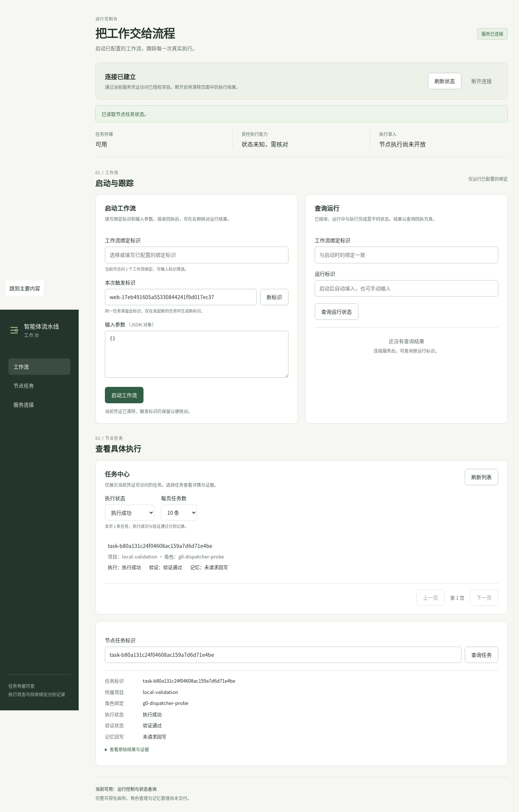
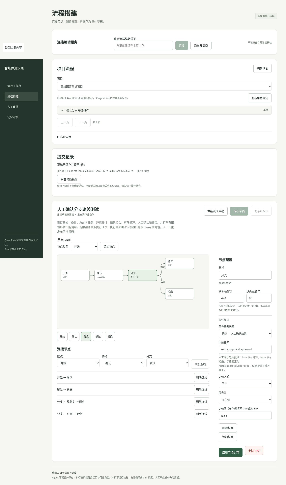
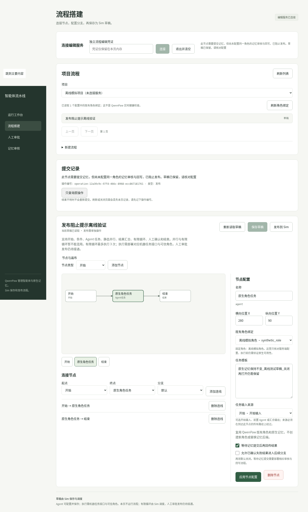
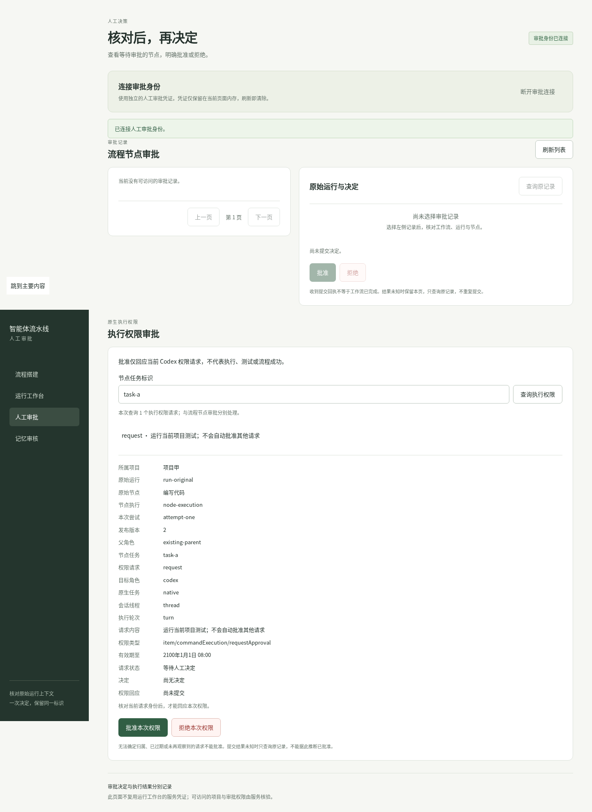
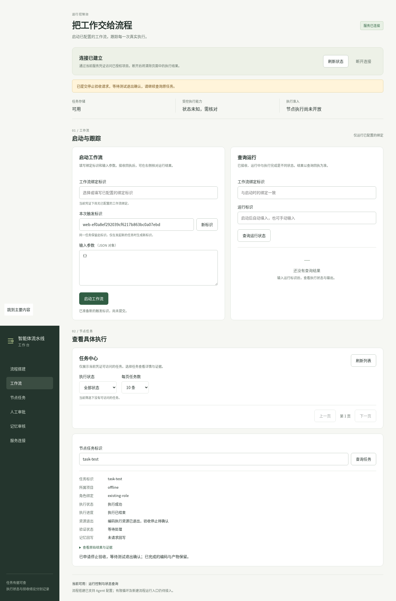

# 智能体流水线

把已有的 QwenPaw 角色、Sim 工作流和 Codex 执行接成一条可查询、可暂停、可核对的中文工作台。扩展不另起一套 Agent 平台：角色、会话和长期记忆仍走 QwenPaw，流程保存与调度仍走 Sim，编码执行仍走 Codex。

当前仓库是这条扩展的源码快照。启动成功或单元测试通过，不等于完整产品需求已经验收。更细的接线记录见 [实施记录](STATUS.md)。

## 它能做什么

- 在工作台启动已配置的流程，按运行标识查询执行、验收和记忆回写，三项分开显示。
- 在流程搭建页连接节点、条件分支和人工确认，草稿先保存在 Sim。
- 发布前检查角色、记忆和结果契约；发布后的原运行继续使用当时的快照。
- 人工审批和 Codex 权限请求分开处理。批准一次请求，不等于测试通过或流程已经结束。
- 取消、时限和额度只阻止新的放行。正在执行的调用，要等后端确认退出后才算停止。

## 界面

下面都是工作台页面的实际截图，来自本地浏览器核对，不是设计稿。

### 任务中心

启动流程、查询运行，并按执行、验收、记忆三项查看节点任务。



### 流程搭建

选择项目和草稿，在画布上连接开始、人工确认和条件分支，再保存到 Sim。



### 发布检查

发布前核对角色绑定和记忆回写。检查没通过时草稿留在原地，不会假装已经发布成功。



### 人工审批

流程节点的批准或拒绝，和 Codex 当前这一次权限请求分开。权限页写明请求范围，不能据此批准其他请求。



### 停止验收

申请停止验收后，页面保持“等待测试退出确认”。编码结果还在，不能把取消申请写成已经停止。



## 代码在哪里

| 目录 | 内容 |
| --- | --- |
| `agent_line/` | 适配服务：任务登记、领取、对账、额度和运行控制 |
| `frontend/` | 工作台页面，原生 HTML / CSS / JavaScript |
| `plugins/agent-line/` | QwenPaw 侧执行插件 |
| `deploy/` | 安装、网关和项目初始化脚本 |
| `tests/` | 单元测试与回归 |
| `probes/` | 隔离探针和浏览器核对 |
| `docs/` | 设计、边界和验收说明 |

运行数据在本机 `var/`，虚拟环境在 `.venv/`，QwenPaw 与 Sim 的上游检出在 `upstream/`。这三处都不进入仓库。服务令牌只放在部署机器的忽略配置里，不要写进页面或提交记录。

## 本地检查

已有虚拟环境时，在仓库根目录运行：

```bash
.venv/bin/python -m unittest discover -s tests -v
python3 scripts/check_upstreams.py
```

上游检查只读锁文件，不会拉取或重置检出。测试通过只说明当前用例成立，不代替真实模型任务的验收。

## 边界

- 凭证留在页面内存，刷新或退出即清除，不写入浏览器存储。
- 提交回执只表示请求已收下。执行是否结束，以查询到的原任务为准。
- 用量未知就显示未知，不补零，也不把估算说成账单。
- 关闭页面不会取消后台任务。重新打开后按原来的运行标识继续查询。

## 许可

源码随仓库公开，便于查阅和交接。QwenPaw、Sim、Codex 及其依赖仍遵循各自上游的许可。
